# Poly Haven: Parks & Gardens HDRIs

**87 assets from [Poly Haven](https://polyhaven.com), dedicated to the public domain under [CC0](https://polyhaven.com/license).** Use them in any game, free or paid, and change them however you like; no credit is needed.

HDRI skies and environments as 1K and 2K Radiance `.hdr` images, for lighting and backgrounds. 730.8 MB in all.

This is a copy kept by [zuujis-cc0](https://github.com/zuujis-cc0) so game makers can take single files from GitHub. It is not made by or affiliated with Poly Haven: the originals, often in more formats and higher resolutions, are on [polyhaven.com](https://polyhaven.com). If they help you, consider [supporting Poly Haven](https://www.patreon.com/polyhaven/overview).

Every file is listed in [MANIFEST.tsv](MANIFEST.tsv) with its size and SHA-256. More free assets: [the Zuujis collection](https://github.com/zuujis-cc0/free-game-assets#readme).

| | | | |
| :-: | :-: | :-: | :-: |
| <a href="acoustical_shell">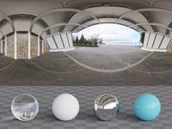</a> <b><a href="acoustical_shell">Acoustical Shell</a></b> by Alexander Scholten · <a href="https://polyhaven.com/a/acoustical_shell">source</a> | <a href="ahornsteig">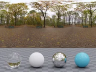</a> <b><a href="ahornsteig">Ahornsteig</a></b> by Greg Zaal · <a href="https://polyhaven.com/a/ahornsteig">source</a> | <a href="air_museum_playground">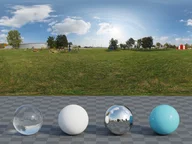</a> <b><a href="air_museum_playground">Air Museum Playground</a></b> by Sergej Majboroda · <a href="https://polyhaven.com/a/air_museum_playground">source</a> | <a href="altanka">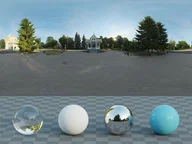</a> <b><a href="altanka">Altanka</a></b> by Sergej Majboroda · <a href="https://polyhaven.com/a/altanka">source</a> |
| <a href="approaching_storm">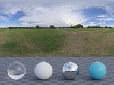</a> <b><a href="approaching_storm">Approaching Storm</a></b> by Greg Zaal · <a href="https://polyhaven.com/a/approaching_storm">source</a> | <a href="autumn_hockey">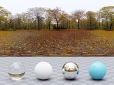</a> <b><a href="autumn_hockey">Autumn Hockey</a></b> by Greg Zaal · <a href="https://polyhaven.com/a/autumn_hockey">source</a> | <a href="autumn_park">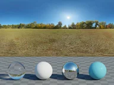</a> <b><a href="autumn_park">Autumn Park</a></b> by Sergej Majboroda · <a href="https://polyhaven.com/a/autumn_park">source</a> | <a href="aviation_museum">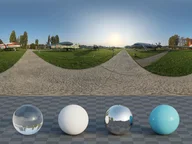</a> <b><a href="aviation_museum">Aviation Museum</a></b> by Sergej Majboroda · <a href="https://polyhaven.com/a/aviation_museum">source</a> |
| <a href="balcony">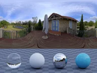</a> <b><a href="balcony">Balcony</a></b> by Greg Zaal · <a href="https://polyhaven.com/a/balcony">source</a> | <a href="ballawley_park">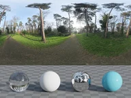</a> <b><a href="ballawley_park">Ballawley Park</a></b> by Savva Zakharov · <a href="https://polyhaven.com/a/ballawley_park">source</a> | <a href="binnenalster">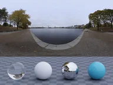</a> <b><a href="binnenalster">Binnenalster</a></b> by Greg Zaal · <a href="https://polyhaven.com/a/binnenalster">source</a> | <a href="bismarckturm">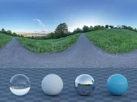</a> <b><a href="bismarckturm">Bismarckturm</a></b> by Andreas Mischok · <a href="https://polyhaven.com/a/bismarckturm">source</a> |
| <a href="bismarckturm_hillside">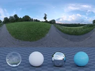</a> <b><a href="bismarckturm_hillside">Bismarckturm Hillside</a></b> by Andreas Mischok · <a href="https://polyhaven.com/a/bismarckturm_hillside">source</a> | <a href="blaubeuren_night">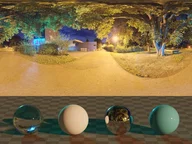</a> <b><a href="blaubeuren_night">Blaubeuren Night</a></b> by Andreas Mischok · <a href="https://polyhaven.com/a/blaubeuren_night">source</a> | <a href="borghese_gardens">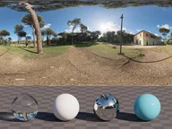</a> <b><a href="borghese_gardens">Borghese Gardens</a></b> by Andreas Mischok · <a href="https://polyhaven.com/a/borghese_gardens">source</a> | <a href="bryanston_park_sunrise">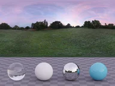</a> <b><a href="bryanston_park_sunrise">Bryanston Park Sunrise</a></b> by Dario Barresi · <a href="https://polyhaven.com/a/bryanston_park_sunrise">source</a> |
| <a href="buikslotermeerplein">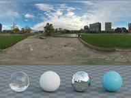</a> <b><a href="buikslotermeerplein">Buikslotermeerplein</a></b> by Greg Zaal · <a href="https://polyhaven.com/a/buikslotermeerplein">source</a> | <a href="charolettenbrunn_park">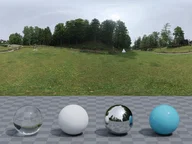</a> <b><a href="charolettenbrunn_park">Charolettenbrunn Park</a></b> by Grzegorz Wronkowski · <a href="https://polyhaven.com/a/charolettenbrunn_park">source</a> | <a href="chinese_garden">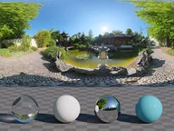</a> <b><a href="chinese_garden">Chinese Garden</a></b> by Andreas Mischok · <a href="https://polyhaven.com/a/chinese_garden">source</a> | <a href="cloudy_vondelpark">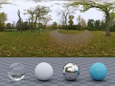</a> <b><a href="cloudy_vondelpark">Cloudy Vondelpark</a></b> by Greg Zaal · <a href="https://polyhaven.com/a/cloudy_vondelpark">source</a> |
| <a href="delta_2">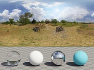</a> <b><a href="delta_2">Delta 2</a></b> by Greg Zaal · <a href="https://polyhaven.com/a/delta_2">source</a> |  <b><a href="donkin_reserve">Donkin Reserve</a></b> by Jenelle van Heerden · <a href="https://polyhaven.com/a/donkin_reserve">source</a> | <a href="eilenriede_park">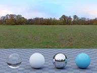</a> <b><a href="eilenriede_park">Eilenriede Park</a></b> by Greg Zaal · <a href="https://polyhaven.com/a/eilenriede_park">source</a> | <a href="emmarentia">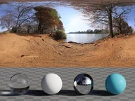</a> <b><a href="emmarentia">Emmarentia</a></b> by Greg Zaal · <a href="https://polyhaven.com/a/emmarentia">source</a> |
| <a href="floral_tent">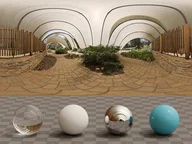</a> <b><a href="floral_tent">Floral Tent</a></b> by Greg Zaal · <a href="https://polyhaven.com/a/floral_tent">source</a> | <a href="forgotten_miniland">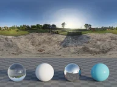</a> <b><a href="forgotten_miniland">Forgotten Miniland</a></b> by Dimitrios Savva, Jarod Guest · <a href="https://polyhaven.com/a/forgotten_miniland">source</a> | <a href="furstenstein">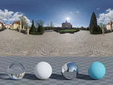</a> <b><a href="furstenstein">Furstenstein</a></b> by Grzegorz Wronkowski · <a href="https://polyhaven.com/a/furstenstein">source</a> | <a href="garden_nook">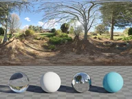</a> <b><a href="garden_nook">Garden Nook</a></b> by Dimitrios Savva, Jarod Guest · <a href="https://polyhaven.com/a/garden_nook">source</a> |
| <a href="graffiti_shelter">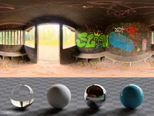</a> <b><a href="graffiti_shelter">Graffiti Shelter</a></b> by Greg Zaal · <a href="https://polyhaven.com/a/graffiti_shelter">source</a> | <a href="graveyard_pathways">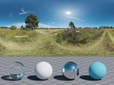</a> <b><a href="graveyard_pathways">Graveyard Pathways</a></b> by Dimitrios Savva, Jarod Guest · <a href="https://polyhaven.com/a/graveyard_pathways">source</a> | <a href="green_point_park">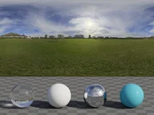</a> <b><a href="green_point_park">Green Point Park</a></b> by Greg Zaal, Rico Cilliers · <a href="https://polyhaven.com/a/green_point_park">source</a> | <a href="greenwich_park">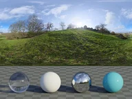</a> <b><a href="greenwich_park">Greenwich Park</a></b> by Andreas Mischok · <a href="https://polyhaven.com/a/greenwich_park">source</a> |
| <a href="greenwich_park_02">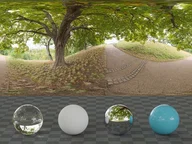</a> <b><a href="greenwich_park_02">Greenwich Park 02</a></b> by Andreas Mischok · <a href="https://polyhaven.com/a/greenwich_park_02">source</a> | <a href="greenwich_park_03">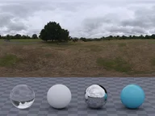</a> <b><a href="greenwich_park_03">Greenwich Park 03</a></b> by Andreas Mischok · <a href="https://polyhaven.com/a/greenwich_park_03">source</a> | <a href="je_gray_park">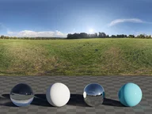</a> <b><a href="je_gray_park">J&E Gray Park</a></b> by Greg Zaal · <a href="https://polyhaven.com/a/je_gray_park">source</a> | <a href="killesberg_park">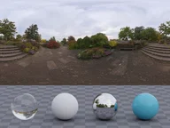</a> <b><a href="killesberg_park">Killesberg Park</a></b> by Andreas Mischok · <a href="https://polyhaven.com/a/killesberg_park">source</a> |
| <a href="ladybrand_heritage_house">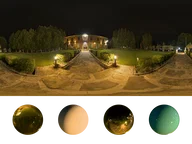</a> <b><a href="ladybrand_heritage_house">Ladybrand Heritage House</a></b> by Dario Barresi · <a href="https://polyhaven.com/a/ladybrand_heritage_house">source</a> | <a href="lapa">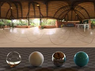</a> <b><a href="lapa">Lapa</a></b> by Greg Zaal · <a href="https://polyhaven.com/a/lapa">source</a> | <a href="limpopo_golf_course">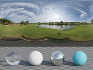</a> <b><a href="limpopo_golf_course">Limpopo Golf Course</a></b> by Dimitrios Savva, Jarod Guest · <a href="https://polyhaven.com/a/limpopo_golf_course">source</a> | <a href="little_paris_under_tower">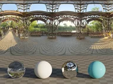</a> <b><a href="little_paris_under_tower">Little Paris Under Tower</a></b> by Dimitrios Savva, Jarod Guest · <a href="https://polyhaven.com/a/little_paris_under_tower">source</a> |
| <a href="lookout">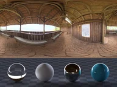</a> <b><a href="lookout">Lookout</a></b> by Greg Zaal · <a href="https://polyhaven.com/a/lookout">source</a> | <a href="lythwood_terrace">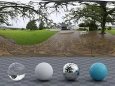</a> <b><a href="lythwood_terrace">Lythwood Terrace</a></b> by Greg Zaal · <a href="https://polyhaven.com/a/lythwood_terrace">source</a> | <a href="museumplein">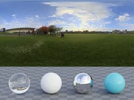</a> <b><a href="museumplein">Museumplein</a></b> by Greg Zaal · <a href="https://polyhaven.com/a/museumplein">source</a> | <a href="nagoya_wall_path">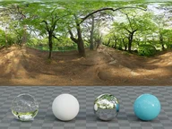</a> <b><a href="nagoya_wall_path">Nagoya Wall Path</a></b> by Greg Zaal · <a href="https://polyhaven.com/a/nagoya_wall_path">source</a> |
| <a href="netball_court">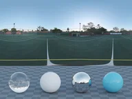</a> <b><a href="netball_court">Netball Court</a></b> by Dimitrios Savva, Jarod Guest · <a href="https://polyhaven.com/a/netball_court">source</a> | <a href="ninomaru_teien">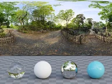</a> <b><a href="ninomaru_teien">Ninomaru Teien</a></b> by Greg Zaal · <a href="https://polyhaven.com/a/ninomaru_teien">source</a> | <a href="old_tree_in_city_park">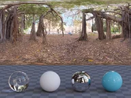</a> <b><a href="old_tree_in_city_park">Old Tree in City Park</a></b> by Andreas Mischok · <a href="https://polyhaven.com/a/old_tree_in_city_park">source</a> | <a href="orlando_stadium">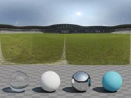</a> <b><a href="orlando_stadium">Orlando Stadium</a></b> by Dimitrios Savva, Greg Zaal · <a href="https://polyhaven.com/a/orlando_stadium">source</a> |
| <a href="outdoor_chapel">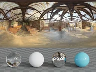</a> <b><a href="outdoor_chapel">Outdoor Chapel</a></b> by Dimitrios Savva, Jarod Guest · <a href="https://polyhaven.com/a/outdoor_chapel">source</a> | <a href="palermo_park">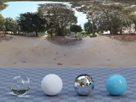</a> <b><a href="palermo_park">Palermo Park</a></b> by Andreas Mischok · <a href="https://polyhaven.com/a/palermo_park">source</a> | <a href="park_bench">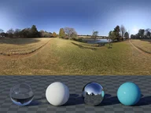</a> <b><a href="park_bench">Park Bench</a></b> by Greg Zaal · <a href="https://polyhaven.com/a/park_bench">source</a> |  <b><a href="park_music_stage">Park Music Stage</a></b> by Grzegorz Wronkowski · <a href="https://polyhaven.com/a/park_music_stage">source</a> |
|  <b><a href="piazza_martin_lutero">Piazza Martin Lutero</a></b> by Greg Zaal, Rico Cilliers · <a href="https://polyhaven.com/a/piazza_martin_lutero">source</a> |  <b><a href="pine_picnic">Pine Picnic</a></b> by Greg Zaal, Jenelle van Heerden · <a href="https://polyhaven.com/a/pine_picnic">source</a> |  <b><a href="pond">Pond</a></b> by Greg Zaal · <a href="https://polyhaven.com/a/pond">source</a> |  <b><a href="pond_bridge_night">Pond Bridge Night</a></b> by Greg Zaal · <a href="https://polyhaven.com/a/pond_bridge_night">source</a> |
|  <b><a href="pool">Pool</a></b> by Greg Zaal · <a href="https://polyhaven.com/a/pool">source</a> |  <b><a href="pretoria_gardens">Pretoria Gardens</a></b> by Dimitrios Savva, Jarod Guest · <a href="https://polyhaven.com/a/pretoria_gardens">source</a> |  <b><a href="qwantani_patio">Qwantani Patio</a></b> by Greg Zaal, Jarod Guest · <a href="https://polyhaven.com/a/qwantani_patio">source</a> |  <b><a href="residential_garden">Residential Garden</a></b> by Greg Zaal, Rico Cilliers · <a href="https://polyhaven.com/a/residential_garden">source</a> |
|  <b><a href="roof_garden">Roof Garden</a></b> by Andreas Mischok · <a href="https://polyhaven.com/a/roof_garden">source</a> |  <b><a href="rooitou_park">Rooitou Park</a></b> by Greg Zaal · <a href="https://polyhaven.com/a/rooitou_park">source</a> |  <b><a href="rosendal_park_sunset">Rosendal Park Sunset</a></b> by Dimitrios Savva, Jarod Guest · <a href="https://polyhaven.com/a/rosendal_park_sunset">source</a> |  <b><a href="sabie_tent">Sabie Tent</a></b> by Greg Zaal · <a href="https://polyhaven.com/a/sabie_tent">source</a> |
|  <b><a href="sisulu">Sisulu</a></b> by Greg Zaal · <a href="https://polyhaven.com/a/sisulu">source</a> |  <b><a href="skate_park">Skate Park</a></b> by Greg Zaal · <a href="https://polyhaven.com/a/skate_park">source</a> |  <b><a href="snowy_cemetery">Snowy Cemetery</a></b> by Andreas Mischok · <a href="https://polyhaven.com/a/snowy_cemetery">source</a> |  <b><a href="snowy_park_01">Snowy Park 01</a></b> by Oliksiy Yakovlyev · <a href="https://polyhaven.com/a/snowy_park_01">source</a> |
|  <b><a href="stadium_01">Stadium 01</a></b> by Sergej Majboroda · <a href="https://polyhaven.com/a/stadium_01">source</a> |  <b><a href="stone_pines">Stone Pines</a></b> by Greg Zaal, Rico Cilliers · <a href="https://polyhaven.com/a/stone_pines">source</a> |  <b><a href="studio_garden">Studio Garden</a></b> by Sergej Majboroda · <a href="https://polyhaven.com/a/studio_garden">source</a> |  <b><a href="suburban_football_field">Suburban Football Field</a></b> by Grzegorz Wronkowski · <a href="https://polyhaven.com/a/suburban_football_field">source</a> |
|  <b><a href="suburban_garden">Suburban Garden</a></b> by Dimitrios Savva, Jarod Guest · <a href="https://polyhaven.com/a/suburban_garden">source</a> |  <b><a href="suburban_soccer_park">Suburban Soccer Park</a></b> by Dimitrios Savva, Jarod Guest · <a href="https://polyhaven.com/a/suburban_soccer_park">source</a> |  <b><a href="sunny_rose_garden">Sunny Rose Garden</a></b> by Dimitrios Savva, Jarod Guest · <a href="https://polyhaven.com/a/sunny_rose_garden">source</a> |  <b><a href="sunny_vondelpark">Sunny Vondelpark</a></b> by Greg Zaal · <a href="https://polyhaven.com/a/sunny_vondelpark">source</a> |
|  <b><a href="sunset_fairway">Sunset Fairway</a></b> by Greg Zaal · <a href="https://polyhaven.com/a/sunset_fairway">source</a> |  <b><a href="symmetrical_garden">Symmetrical Garden</a></b> by Greg Zaal · <a href="https://polyhaven.com/a/symmetrical_garden">source</a> |  <b><a href="symmetrical_garden_02">Symmetrical Garden 02</a></b> by Dimitrios Savva, Jarod Guest · <a href="https://polyhaven.com/a/symmetrical_garden_02">source</a> |  <b><a href="tiergarten">Tiergarten</a></b> by Greg Zaal · <a href="https://polyhaven.com/a/tiergarten">source</a> |
|  <b><a href="turning_area">Turning Area</a></b> by Alexander Scholten · <a href="https://polyhaven.com/a/turning_area">source</a> |  <b><a href="veranda">Veranda</a></b> by Greg Zaal · <a href="https://polyhaven.com/a/veranda">source</a> |  <b><a href="viale_giuseppe_garibaldi">Viale Giuseppe Garibaldi</a></b> by Greg Zaal, Rico Cilliers · <a href="https://polyhaven.com/a/viale_giuseppe_garibaldi">source</a> |  <b><a href="whipple_creek_gazebo">Whipple Creek Gazebo</a></b> by Philip Modin · <a href="https://polyhaven.com/a/whipple_creek_gazebo">source</a> |
|  <b><a href="whipple_creek_regional_park_01">Whipple Creek Regional Park 01</a></b> by Philip Modin · <a href="https://polyhaven.com/a/whipple_creek_regional_park_01">source</a> |  <b><a href="whipple_creek_regional_park_04">Whipple Creek Regional Park 04</a></b> by Philip Modin · <a href="https://polyhaven.com/a/whipple_creek_regional_park_04">source</a> |  <b><a href="xiequ_yuan">Xiequ Yuan</a></b> by Greg Zaal · <a href="https://polyhaven.com/a/xiequ_yuan">source</a> |  |

---

Kept up to date by this repository's own [update workflow](.github/workflows/update.yml), with code and plan from [cc0-mirror](https://github.com/zuujis-cc0/cc0-mirror). Something wrong? [Open an issue there](https://github.com/zuujis-cc0/cc0-mirror/issues/new) or use the [private report form](https://games.zuujis.com/report).
